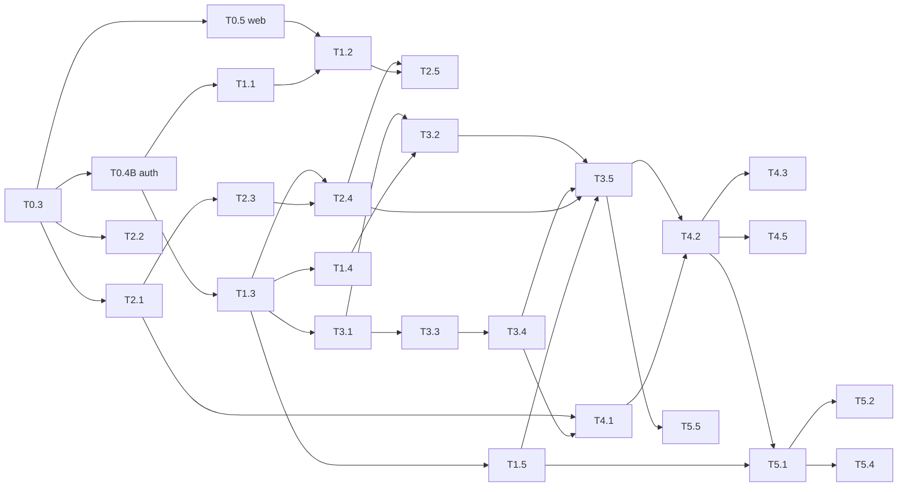

# Bảng chia task — DenimFlow BO

Bảng này để **chia việc**: mỗi thành viên tự chọn task, điền tên mình vào. Chi tiết từng task (cần làm gì, tiêu chí nghiệm thu) nằm trong các file `.agents/tasks/S*.md`, link ở cột **Mã**. Khi bảng này và task file lệch nhau, task file là chuẩn.

Cập nhật: 2026-10-18 (sau PR #28).

## Cách nhận task

1. Đọc trước: [`AGENTS.md`](../AGENTS.md), [`docs/vi/GETTING_STARTED.md`](vi/GETTING_STARTED.md) (cài đặt) và [`Tutorial_denimflow-bo.md`](../Tutorial_denimflow-bo.md) (nhánh, commit, PR).
2. Chọn một task ở mục **Làm được ngay** (mọi task nó phụ thuộc đã xong), cột *Người nhận* còn trống.
3. Mở một PR nhỏ chỉ sửa file này: điền tên GitHub của bạn vào *Người nhận*, đổi *Trạng thái* thành `Đang làm`. PR merge trước thì người đó nhận task.
4. Làm trên nhánh đúng tên ghi trong task file, **một task = một nhánh = một PR**. Khi mở PR của task, ghi mã task (ví dụ `T2.1`) trong mô tả.
5. Mỗi người nhận **tối đa 2 task đang làm** cùng lúc. Bỏ task thì mở PR xoá tên mình để người khác nhận.
6. Khi PR của task merge: cập nhật *Trạng thái* = `Xong` và cột *PR* (có thể gộp vào chính PR của task).

Ký hiệu: ✅ xong · 🟢 làm được ngay · ⏳ chờ task khác · 👤 việc của owner (thao tác trên dashboard, agent không làm) · ☁️ cần Supabase (T0.1) để nghiệm thu đầy đủ.

## Làm được ngay

Cập nhật 2026-10-18: Sprint 1–3 và T4.1 đã vào `main` qua #26 (gộp, chưa review). Việc ưu tiên bây giờ là **trả nợ kỹ thuật** của #26 và các task còn trống. Ưu tiên các bạn chưa có task (nht2k4, fongcuten, khoaSE18); mỗi người tối đa 2 task.

| Mã | Việc | Ghi chú |
|---|---|---|
| D1 | Migration mới: đổi các `ON DELETE CASCADE` sang `RESTRICT` (order, workflow instance, allocation, acknowledgement...), thêm trigger append-only cho `step_quantity_entries` | Không sửa migration đã merge, tạo migration mới. Xem DATABASE_DESIGN §2, §4 (R-03) |
| D2 | Chuyển các `assertAdmin` / `assertPlannerOrAdmin` / `assertAuthenticated` còn lại (users, catalog ghi, order, inventory) sang `@UseGuards(AuthGuard)` + `@Roles(...)` | Guard có sẵn từ #28; rule 01 |
| D3 | Workflow: truyền id người thao tác vào `createTemplate` / `publishVersion` / `assignTemplateToStyle` để `created_by` và audit log không bị null | BR-16 |
| D4 | Review lại code đã merge qua #26 theo module (catalog, order, inventory, web), mỗi người một module; ghi lỗi tìm được thành task hoặc PR nhỏ | Dùng checklist trong `.agents/rules/` |
| [T5.5](../.agents/tasks/S5-qc-rework-dashboard.md) | Dashboard WIP | Phụ thuộc T3.5 đã có trên `main` |
| [T5.6](../.agents/tasks/S5-qc-rework-dashboard.md) | Xem AuditLog (tuỳ chọn) | Phụ thuộc T0.4A đã có |
| [T0.1](../.agents/tasks/S0-scaffold-and-pipeline.md) 👤 | Tạo project Supabase `denimflow-prod` | Owner |
| [T0.7](../.agents/tasks/S0-scaffold-and-pipeline.md) 👤 | Deploy lần đầu (Render, Cloudflare, ADR Pages/Workers) | Owner, sau T0.1 |
| [T0.8](../.agents/tasks/S0-scaffold-and-pipeline.md) 👤 | Thêm `CODEOWNERS` (check `CI` bắt buộc đã bật) | Owner |

> **Lưu ý về PR đang mở:** owner làm lại #27, #29–#34 thành **từng PR mới từ `main`, lần lượt, không xếp chồng** (giữ ghi công `Co-authored-by: tmdzvkl`). T4.2 đã merge (#43); T4.3 (thay #29) đã có PR; T4.4 chỉ bắt đầu sau khi PR T4.3 merge. Đừng mở thêm PR chồng lên #27–#34.

## Bảng đầy đủ

### Sprint 0 — Khung dự án và pipeline

| Mã | Việc | FR/BR | Phụ thuộc | Mức | Người nhận | Trạng thái | PR |
|---|---|---|---|---|---|---|---|
| [T0.1](../.agents/tasks/S0-scaffold-and-pipeline.md) 👤 | Tạo 2 project Supabase dev/prod | — | — | MVP | Owner | Dev ✅, prod 🟢 | |
| [T0.2](../.agents/tasks/S0-scaffold-and-pipeline.md) | Monorepo root (pnpm, TS, ESLint, Prettier, Husky) | — | — | MVP | | ✅ | #3 |
| [T0.3](../.agents/tasks/S0-scaffold-and-pipeline.md) | Skeleton `shared` + `engine` (build ESM + CJS) | — | T0.2 | MVP | | ✅ | #4 |
| [T0.4A](../.agents/tasks/S0-scaffold-and-pipeline.md) | API skeleton: NestJS, Prisma, `/health`, migration đầu | BR-16 | T0.3 | MVP | | ✅ (đã kiểm tra trên Supabase dev) | #6 |
| [T0.4B](../.agents/tasks/S0-scaffold-and-pipeline.md) | API auth: JWT guard, roles, `/me`, seed 7 user | — | T0.4A | MVP ☁️ | tmdzvkl | ✅ Đã merge (#26, chưa review) | #26 |
| [T0.5](../.agents/tasks/S0-scaffold-and-pipeline.md) | Web skeleton: Login, layout bảo vệ, Home | — | T0.3 | MVP ☁️ | tmdzvkl | ✅ Đã merge (#26, chưa review) | #26 |
| [T0.6](../.agents/tasks/S0-scaffold-and-pipeline.md) | CI + keep-alive (GitHub Actions) | — | T0.2 | MVP | | ✅ | #7 |
| [T0.7](../.agents/tasks/S0-scaffold-and-pipeline.md) 👤 | Deploy lần đầu: Render (API), Cloudflare (web), migrate prod, ADR Pages/Workers | — | T0.1, T0.4B, T0.5 | MVP ☁️ | Owner | ⏳ | |
| [T0.8](../.agents/tasks/S0-scaffold-and-pipeline.md) 👤 | Bắt buộc check `CI` trước khi merge, CODEOWNERS | — | T0.6 | MVP | Owner | 🟢 | |

### Sprint 1 — Đăng nhập, phân quyền, dữ liệu danh mục

| Mã | Việc | FR/BR | Phụ thuộc | Mức | Người nhận | Trạng thái | PR |
|---|---|---|---|---|---|---|---|
| [T1.1](../.agents/tasks/S1-auth-rbac-master-data.md) | Admin quản lý user: tạo, khoá, liệt kê (seed đã làm ở T0.4B) | FR-01 | T0.4B | MVP ☁️ | tmdzvkl | ✅ Đã merge (#26, chưa review) | #26 |
| [T1.2](../.agents/tasks/S1-auth-rbac-master-data.md) | Web: menu theo role, chặn route, trang 403 | FR-01 | T0.5, T1.1 | MVP | tmdzvkl | ✅ Đã merge (#26, chưa review) | #26 |
| [T1.3](../.agents/tasks/S1-auth-rbac-master-data.md) | Danh mục: Style, FabricType, ColorOption, WashType, Station (bảng + CRUD + màn hình) | FR-02 | T0.4B | MVP | tmdzvkl | ✅ Đã merge (#26, chưa review) | #26 |
| [T1.4](../.agents/tasks/S1-auth-rbac-master-data.md) | Ma trận vải–màu (Fabric–Color Matrix) | FR-02, BR-04 | T1.3 | MVP | tmdzvkl | ✅ Đã merge (#26, chưa review) | #26 |
| [T1.5](../.agents/tasks/S1-auth-rbac-master-data.md) | Cấu hình QC Profile (chỉ dữ liệu) | FR-28, BR-19 | T1.3 | MVP | tmdzvkl | ✅ Đã merge (#26, chưa review) | #26 |

### Sprint 2 — Workflow engine và trình thiết kế

| Mã | Việc | FR/BR | Phụ thuộc | Mức | Người nhận | Trạng thái | PR |
|---|---|---|---|---|---|---|---|
| [T2.1](../.agents/tasks/S2-workflow-engine-and-designer.md) | Engine: domain model + State machine | FR-11 | T0.3 | MVP | nht2k4 | Đang làm | |
| [T2.2](../.agents/tasks/S2-workflow-engine-and-designer.md) | Engine: điều kiện (Strategy) + JSON AST | FR-04 | T0.3 | MVP | tmdzvkl | ✅ Đã merge (#26, chưa review) | #26 |
| [T2.3](../.agents/tasks/S2-workflow-engine-and-designer.md) | Engine: kiểm tra template hợp lệ | FR-05, BR-01 | T2.1 | MVP | tmdzvkl | ✅ Đã merge (#26, chưa review) | #26 |
| [T2.4](../.agents/tasks/S2-workflow-engine-and-designer.md) | Lưu template/version vào DB + publish, seed "Jean Standard" | FR-04, FR-05, BR-01, BR-02 | T2.3, T1.3 | MVP | tmdzvkl | ✅ Đã merge (#26, chưa review); seed sửa ở #35 | #26, #35 |
| [T2.5](../.agents/tasks/S2-workflow-engine-and-designer.md) | Web: trình thiết kế workflow (form + đồ thị React Flow chỉ xem) | FR-04, FR-05 | T2.4, T1.2 | MVP | tmdzvkl | ✅ Đã merge (#26, chưa review) | #26 |

### Sprint 3 — Đơn hàng, Confirm, snapshot

| Mã | Việc | FR/BR | Phụ thuộc | Mức | Người nhận | Trạng thái | PR |
|---|---|---|---|---|---|---|---|
| [T3.1](../.agents/tasks/S3-order-confirm-snapshot.md) | Đơn nháp và các dòng size | FR-07 | T1.3 | MVP | tmdzvkl | ✅ Đã merge (#26, chưa review) | #26 |
| [T3.2](../.agents/tasks/S3-order-confirm-snapshot.md) | Chọn vải và màu (kiểm tra ma trận) | FR-08, BR-04, BR-05 | T3.1, T1.4 | MVP | tmdzvkl | ✅ Đã merge (#26, chưa review) | #26 |
| [T3.3](../.agents/tasks/S3-order-confirm-snapshot.md) | Tính BOM (Strategy) | FR-09 | T3.1 | MVP | tmdzvkl | ✅ Đã merge (#26, chưa review) | #26 |
| [T3.4](../.agents/tasks/S3-order-confirm-snapshot.md) | Phân bổ vải và Material Request | FR-09, BR-06 | T3.3 | MVP | tmdzvkl | ✅ Đã merge (#26, chưa review) | #26 |
| [T3.5](../.agents/tasks/S3-order-confirm-snapshot.md) | Confirm đơn (snapshot trong một transaction) | FR-07, FR-11, BR-03, BR-16, BR-18, BR-19 | T3.2, T3.4, T2.4, T1.5 | MVP | tmdzvkl | ✅ Đã merge (#26, chưa review) | #26 |

### Sprint 4 — Thực thi, Gate, số lượng

| Mã | Việc | FR/BR | Phụ thuộc | Mức | Người nhận | Trạng thái | PR |
|---|---|---|---|---|---|---|---|
| [T4.1](../.agents/tasks/S4-execution-gates-quantities.md) | Engine: chuỗi Gate (Chain of Responsibility) | FR-11, BR-14, BR-06, BR-08, BR-15 | T2.1, T3.4 | MVP | tmdzvkl | ✅ Đã merge (#26, chưa review) | #26 |
| [T4.2](../.agents/tasks/S4-execution-gates-quantities.md) | Worklist, Start và Complete bước | FR-12, BR-11, BR-16 | T3.5, T4.1 | MVP | phuc220204 (làm lại từ #27 của tmdzvkl) | ✅ Đã merge | #43 |
| [T4.3](../.agents/tasks/S4-execution-gates-quantities.md) | Nhập số lượng, bảo toàn số lượng (có test đồng thời) | FR-13, BR-07, BR-08, BR-09 | T4.2 | MVP | phuc220204 (làm lại từ #29 của tmdzvkl) | 🔄 PR mới từ `main`, chờ review | thay #29 |
| [T4.4](../.agents/tasks/S4-execution-gates-quantities.md) | Bằng chứng (ảnh/file) cho bước | FR-14, BR-15 | T4.2 | Tuỳ chọn ☁️ | tmdzvkl | 🔄 PR mở, chồng trên #27 | #30 |
| [T4.5](../.agents/tasks/S4-execution-gates-quantities.md) | Tách biệt nhiệm vụ (người làm không tự duyệt) | BR-11 | T4.2 | MVP | tmdzvkl | 🔄 PR mở, chồng trên #27 | #31 |

### Sprint 5 — QC, làm lại, dashboard, bàn giao

| Mã | Việc | FR/BR | Phụ thuộc | Mức | Người nhận | Trạng thái | PR |
|---|---|---|---|---|---|---|---|
| [T5.1](../.agents/tasks/S5-qc-rework-dashboard.md) | Kiểm tra QC theo QC Profile | FR-16, BR-11, BR-19 | T4.2, T1.5 | MVP | tmdzvkl | 🔄 PR mở, chồng trên #27 | #32 |
| [T5.2](../.agents/tasks/S5-qc-rework-dashboard.md) | Định tuyến làm lại (rework), giới hạn số vòng | FR-17, BR-10 | T5.1 | MVP | tmdzvkl | 🔄 PR mở, chồng trên #27 | #33 |
| [T5.3](../.agents/tasks/S5-qc-rework-dashboard.md) | Ghi nhận lỗi (defects) | FR-18 | T5.1 | Tuỳ chọn | tmdzvkl | 🔄 PR mở, chồng trên #27 | #34 |
| [T5.4](../.agents/tasks/S5-qc-rework-dashboard.md) | Đóng gói và bàn giao | FR-26 | T5.1 | MVP | | ⏳ | |
| [T5.5](../.agents/tasks/S5-qc-rework-dashboard.md) | Dashboard WIP | FR-21 | T3.5 | MVP | | 🟢 | |
| [T5.6](../.agents/tasks/S5-qc-rework-dashboard.md) | Xem AuditLog | FR-25 | T0.4A | Tuỳ chọn | | 🟢 | |
| [T5.7](../.agents/tasks/S5-qc-rework-dashboard.md) | E2E kịch bản demo và hoàn thiện | — | tất cả, T0.7 | MVP ☁️ | | ⏳ | |

## Sơ đồ phụ thuộc

Mũi tên `A --> B` nghĩa là B cần A xong trước. GitHub tự vẽ sơ đồ này.

## Lưu ý khi làm song song

- **Migration:** hai người cùng thêm migration Prisma dễ đụng nhau. Trước khi tạo migration, `git pull` `main` mới nhất; nếu `main` đã có migration mới thì rebase rồi tạo lại migration của bạn.
- **`pnpm-lock.yaml` conflict:** lấy bản của `main` rồi chạy lại `pnpm install` (rule 03).
- **Chung file:** `packages/shared` (enum, schema) là hợp đồng giữa web và API; đổi gì ở đó thì báo người đang làm task liên quan.
