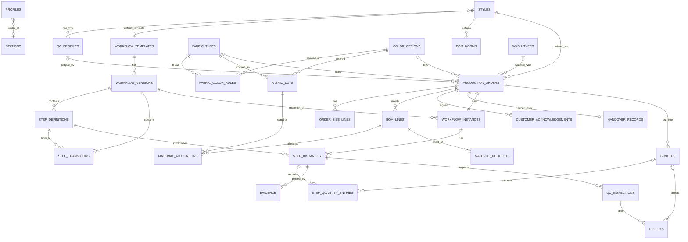

# DATABASE_DESIGN — DenimFlow BO

Version 0.1 (draft design, schema not yet implemented) · 2026-10-16 · Language: EN (canonical) · Mirror: `docs/vi/DATABASE_DESIGN.md`
Source: Proposal V2.0 §10 (core data model) plus the additions listed in §10 here (R-xx ids refer to `BUSINESS_RECONCILIATION.md` §7).

## 1. Principles

1. **PostgreSQL on Supabase**, accessed by the NestJS API through Prisma. The web never queries tables directly.
2. **The workflow is data.** Templates → versions → step definitions → transitions. A published version is immutable (BR-02); an order points to a version (snapshot, BR-03).
3. **Integrity in the database where it is cheap and absolute** (unique, FK, CHECK, partial unique indexes, triggers); **rules that need business context in the engine/API** (see §6).
4. **Everything that changes state leaves an audit row** in the same transaction (BR-16).
5. **Deny-all RLS** on every table; real authorization is in the API (see §8).

## 2. Conventions

| Topic | Convention |
|---|---|
| Table names | snake_case plural (`step_instances`); Prisma model PascalCase singular with `@@map` |
| Column names | snake_case; Prisma field camelCase with `@map` |
| Primary key | `id uuid` default `gen_random_uuid()`; `audit_logs.id` is `bigint` identity (ordering) |
| Timestamps | `timestamptz`, UTC; `created_at`, `updated_at` where rows change |
| Enums | PostgreSQL enums via Prisma enums (§5) |
| Booleans | `is_*` or `*_required`, `NOT NULL` with default |
| Quantities | pieces = `integer` ≥ 0; fabric = `numeric(12,2)` meters |
| Soft delete | Not used. Catalog rows use `is_active`; referenced rows cannot be deleted |
| Money | out of scope |
| Files | store Storage **paths**, never public URLs (R-15) |

## 3. Entity relationship diagram



Not drawn (post-MVP): `workflow_change_requests`. `audit_logs` is polymorphic (`entity_type`, `entity_id`) and has no foreign keys by design.

## 4. Tables

Notation: `PK`, `FK → table`, `UQ`, `NN` (not null), `CK` (check). Unlisted columns `created_at`/`updated_at` are standard.

### 4.1 Catalog (module `catalog`, `inventory`)

| Table | Columns |
|---|---|
| `profiles` | `id uuid PK` (= Supabase `auth.users.id`), `full_name NN`, `email NN UQ`, `role Role NN`, `station_id FK → stations NULL`, `is_active NN default true` |
| `stations` | `id PK`, `code NN UQ`, `name NN`, `station_type StationType NN`, `is_outsourced NN default false` |
| `styles` | `id PK`, `style_code NN UQ`, `name NN`, `fit_type`, `default_template_id FK → workflow_templates NULL`, `has_embroidery NN default false`, `is_active NN` |
| `fabric_types` | `id PK`, `code NN UQ`, `weight_oz numeric(4,1)`, `composition`, `stretch_type StretchType NN` |
| `color_options` | `id PK`, `code NN UQ`, `name NN`, `color_family` |
| `fabric_color_rules` | `id PK`, `fabric_type_id FK NN`, `color_id FK NN`, `is_allowed NN`; **UQ(fabric_type_id, color_id)** |
| `wash_types` | `id PK`, `code NN UQ`, `name NN` (R-08) |
| `fabric_lots` | `id PK`, `fabric_type_id FK NN`, `color_id FK NN`, `lot_no NN UQ`, `available_meters numeric(12,2) NN CK ≥ 0`, `shrinkage_percent numeric(5,2)` |
| `qc_profiles` | `id PK`, `style_id FK NN`, `profile_type QcProfileType NN`, `max_shrinkage_percent numeric(5,2) NN`, `max_color_fading_level smallint NN` (0 = none … 5 = severe; lower is better), `is_active NN`; **UQ(style_id, profile_type)** |
| `bom_norms` | `id PK`, `style_id FK NN`, `size NN`, `material_type MaterialType NN`, `qty_per_piece numeric(10,3) NN`, `unit NN`, `wastage_percent numeric(5,2) NN default 0` (R-16) |

### 4.2 Workflow (module `workflow`)

| Table | Columns |
|---|---|
| `workflow_templates` | `id PK`, `name NN`, `is_active NN default true`, `is_dedicated NN default false`, `order_id uuid NULL` (post-MVP custom branch, R-04), `current_version_id FK → workflow_versions NULL` |
| `workflow_versions` | `id PK`, `template_id FK NN`, `version_no int NN`, `status VersionStatus NN`, `published_at`, `created_by FK → profiles`; **UQ(template_id, version_no)**; **partial UQ(template_id) WHERE status='PUBLISHED'** |
| `step_definitions` | `id PK`, `version_id FK NN`, `code NN`, `name NN`, `step_type StepType NN`, `seq int NN`, `responsible_role Role NN`, `station_type StationType NULL`, `is_mandatory NN`, `requires_evidence NN default false`, `requires_qc NN default false`, `condition_expr jsonb NULL` (JSON AST, R-09), `max_rework smallint NULL`, `is_start NN default false`, `is_end NN default false`; **UQ(version_id, code)** (R-07) |
| `step_transitions` | `id PK`, `version_id FK NN`, `from_step_id FK NN`, `to_step_id FK NN`, `condition_expr jsonb NULL`, `kind TransitionKind NN`; **UQ(version_id, from_step_id, to_step_id, kind)** |

`condition_expr` examples (Zod-validated in `packages/shared`): `{"op":"eq","field":"order.dyeRequired","value":true}`, `{"op":"not","arg":{"op":"eq","field":"order.skipCleanWash","value":true}}`, `{"op":"neq","field":"order.washTypeId","value":null}`.

### 4.3 Production order (modules `order`, `inventory`)

| Table | Columns |
|---|---|
| `production_orders` | `id PK`, `order_number NN UQ` (`PO-YYYY-NNNN`), `style_id FK NN`, `fabric_type_id FK NULL`, `color_id FK NULL`, `wash_type_id FK → wash_types NULL`, `dye_required NN default false`, `dye_mode DyeMode NULL`, `dye_source DyeSource NULL`, `embroidery_required NN default false`, `fabric_inspect_required NN default false`, `pp_sample_required NN default false`, `skip_clean_wash NN default false`, `qc_profile_id FK NULL` (set at Confirm), `is_custom NN default false`, `status OrderStatus NN default DRAFT`, `due_date date NN`, `customer_ref`, `notes`, `created_by FK NN`, `confirmed_at NULL`, `version int NN default 0` (optional optimistic lock); **CK** `NOT dye_required OR (dye_mode IS NOT NULL AND dye_source IS NOT NULL)` |
| `order_size_lines` | `id PK`, `order_id FK NN`, `size NN`, `planned_qty int NN CK > 0`; **UQ(order_id, size)** |
| `bom_lines` | `id PK`, `order_id FK NN`, `material_type MaterialType NN`, `required_qty numeric(12,3) NN`, `unit NN` |
| `material_allocations` | `id PK`, `bom_line_id FK NN`, `fabric_lot_id FK NN`, `allocated_qty numeric(12,3) NN CK > 0` |
| `material_requests` | `id PK`, `order_id FK NN`, `bom_line_id FK NN`, `missing_qty numeric(12,3) NN`, `status RequestStatus NN default OPEN`, `requested_by FK NN` (R-02) |
| `customer_acknowledgements` | `id PK`, `order_id FK NN`, `ack_type AckType NN`, `qc_profile_id FK NN`, `file_path NN`, `acknowledged_by_name NN` (customer's signatory), `acknowledged_at NN`, `recorded_by FK NN` (R-15) |
| `handover_records` | `id PK`, `order_id FK NN UQ`, `qc_profile_id FK NN`, `packing_list jsonb NN`, `total_qty int NN`, `handed_over_by FK NN`, `handed_over_at NN`, `notes` (R-16) |

### 4.4 Operation (modules `execution`, `quality`, `audit`)

| Table | Columns |
|---|---|
| `workflow_instances` | `id PK`, `order_id FK NN UQ`, `version_id FK NN`, `status InstanceStatus NN` |
| `step_instances` | `id PK`, `instance_id FK NN`, `step_definition_id FK NN`, `status StepStatus NN default PENDING`, `assigned_to FK NULL`, `performed_by FK NULL`, `started_at`, `completed_at`, `qty_in int NULL`, `qty_good int NULL`, `qty_defect int NULL`, `rework_count smallint NN default 0`; **UQ(instance_id, step_definition_id)**; **CK** quantities ≥ 0 |
| `bundles` | `id PK`, `order_id FK NN`, `bundle_code NN`, `size NN`, `qty int NN CK > 0`, `current_step_instance_id FK NULL`; **UQ(order_id, bundle_code)** |
| `step_quantity_entries` | `id PK`, `step_instance_id FK NN`, `bundle_id FK NULL`, `size NULL`, `qty_good int NN CK ≥ 0`, `qty_defect int NN CK ≥ 0`, `note`, `entered_by FK NN`, `entered_at NN` — append-only (R-03) |
| `evidence` | `id PK`, `step_instance_id FK NN`, `file_path NN`, `note`, `uploaded_by FK NN`, `uploaded_at NN` |
| `qc_inspections` | `id PK`, `step_instance_id FK NN`, `inspector_id FK NN`, `qc_profile_id FK NULL`, `sample_size int NN`, `measured_shrinkage_percent numeric(5,2) NULL`, `measured_color_fading_level smallint NULL`, `result QcResult NN`, `rework_target_step_id FK → step_instances NULL`, `reason`, `notes` |
| `defects` | `id PK`, `inspection_id FK NN`, `bundle_id FK NULL`, `defect_type NN`, `qty int NN CK > 0` |
| `audit_logs` | `id bigint identity PK`, `entity_type NN`, `entity_id uuid NN`, `action NN`, `old_value jsonb`, `new_value jsonb`, `actor_id uuid NULL` (NULL = system), `created_at NN default now()` — **append-only** |
| `workflow_change_requests` *(post-MVP)* | `id PK`, `instance_id FK`, `requested_by FK`, `payload jsonb`, `status ChangeRequestStatus`, `approved_by FK NULL` |

## 5. Enums

| Enum | Values |
|---|---|
| `Role` | ADMIN, PROCESS_ENGINEER, PRODUCTION_PLANNER, WAREHOUSE_KEEPER, STATION_OPERATOR, QC_INSPECTOR, MANAGER |
| `StationType` | CUTTING, SEWING, EMBROIDERY, DYEING, WASH, FINISHING, QC, PACKING |
| `StretchType` | RIGID, STRETCH |
| `QcProfileType` | FULL_PROCESS, SKIP_CLEAN_WASH |
| `VersionStatus` | DRAFT, PUBLISHED, RETIRED |
| `StepType` | SELECTION, MATERIAL, PRODUCTION, QC, APPROVAL |
| `TransitionKind` | NORMAL, REWORK |
| `OrderStatus` | DRAFT, CONFIRMED, IN_PRODUCTION, ON_HOLD, COMPLETED, CANCELLED |
| `InstanceStatus` | RUNNING, COMPLETED, CANCELLED |
| `StepStatus` | PENDING, READY, IN_PROGRESS, WAITING_QC, REWORK, DONE, SKIPPED |
| `DyeMode` | TOTAL, PARTIAL |
| `DyeSource` | INTERNAL, OUTSOURCED |
| `MaterialType` | FABRIC, THREAD, BUTTON, RIVET, ZIPPER, LABEL, PACKAGING |
| `RequestStatus` | OPEN, ORDERED, RECEIVED, CANCELLED |
| `AckType` | SKIP_CLEAN_WASH |
| `QcResult` | PASS, REWORK, REJECT |
| `ChangeRequestStatus` | PENDING, APPROVED, REJECTED |

The same enums are defined once in `packages/shared` and mirrored in `schema.prisma`; keep them identical.

## 6. Integrity rules and indexes

| Rule | Database mechanism | Remaining in engine/API |
|---|---|---|
| BR-02 one PUBLISHED version per template | Partial unique index `workflow_versions(template_id) WHERE status='PUBLISHED'` | Publish use-case retires the old one in the same transaction |
| BR-02 immutable published version | Trigger `BEFORE INSERT/UPDATE/DELETE` on `step_definitions` and `step_transitions` raising if the parent version is not DRAFT | API also rejects (friendly error) |
| BR-16 AuditLog append-only | Trigger `BEFORE UPDATE OR DELETE` on `audit_logs` raising an exception; statement trigger `BEFORE TRUNCATE` | Written in the same transaction as the change |
| BR-04 valid fabric–color | `UQ(fabric_type_id, color_id)` on the matrix | API checks `is_allowed` |
| BR-06 allocation ≤ stock | `CK available_meters ≥ 0` on `fabric_lots`; row lock when allocating (§7) | Gate (engine) for CUTTING |
| BR-08 quantity conservation | `CK` non-negative quantities; row lock on `step_instances` (§7.2) | Cross-step comparison in the engine (cannot be a CHECK) |
| BR-19 acknowledgement before Confirm | — | Confirm use-case checks a `customer_acknowledgements` row exists |
| One instance per order | `UQ(order_id)` on `workflow_instances` | — |
| Dye data complete | `CK` on `production_orders` (§4.3) | — |

Indexes (besides PK/UQ above): FK columns used in joins (`step_instances.instance_id`, `step_instances.step_definition_id`, `order_size_lines.order_id`, `bom_lines.order_id`, `material_allocations.bom_line_id`, `bundles.order_id`, `evidence.step_instance_id`, `qc_inspections.step_instance_id`); worklist `step_instances(status)` plus a join to `step_definitions(station_type, responsible_role)`; dashboard `production_orders(status, due_date)`; audit `audit_logs(entity_type, entity_id, created_at)` and `audit_logs(created_at)`. Add more only after measuring.

## 7. Transactions and concurrency

Use Prisma **interactive transactions** (`prisma.$transaction(async (tx) => ...)`). The pooled (transaction-mode) connection supports them because the whole transaction runs on one connection.

### 7.1 Confirm order (FR-07, BR-03, BR-18, BR-19)

```
BEGIN
 1. SELECT order FOR UPDATE; require status = DRAFT            -- a second Confirm waits, then fails (409)
 2. style → default template → PUBLISHED version (else BR-03 error)
 3. validate completeness; reject isCustom (R-04);
    if skip_clean_wash: require customer_acknowledgements row (BR-19)
 4. pick qc_profile by skip_clean_wash → orders.qc_profile_id
 5. engine.buildInstance(stepDefinitions, orderFlags) → initial status per step
    (condition false → SKIPPED; CLEAN_WASH skipped by flag → SKIPPED + audit)
 6. INSERT workflow_instances + step_instances; ORDER_CONFIRM = DONE (R-05); first eligible step READY
 7. UPDATE order status = CONFIRMED, confirmed_at
 8. INSERT audit_logs (order, instance, each skipped step)
COMMIT                                                          -- any error ⇒ ROLLBACK, no partial data
```

### 7.2 Quantity entry (FR-13, BR-07, BR-08, BR-09)

```
BEGIN
 1. SELECT ... FROM step_instances WHERE id = :id FOR UPDATE    -- serializes entries on the same step
    (lock the previous step row too, always in ascending id order to avoid deadlocks)
 2. engine.validateQuantityEntry(current, previous, entry, tolerance)
 3. INSERT step_quantity_entries; UPDATE step_instances aggregates
 4. INSERT audit_logs
COMMIT
```

| Approach | Pros | Cons |
|---|---|---|
| **Pessimistic lock (`FOR UPDATE`) — chosen** | Simple to reason about; no retry logic; matches the rule "two entries must not jointly exceed" | Holds a lock briefly; needs a raw query in Prisma |
| Optimistic (`version` column + retry) | No locks | Retry code on every write path; conflicts surface to users |

Allocation (`material_allocations`) uses the same pattern on the `fabric_lots` row.

### 7.3 QC decision (FR-16, FR-17, BR-10, BR-11, BR-19)

Lock the inspected step row (and the rework target); check BR-11 (inspector ≠ performer); the engine picks thresholds from the order's `qc_profile_id` and returns the proposed result; insert `qc_inspections`; on REWORK set the target step `REWORK` and increment `rework_count` (over `max_rework` ⇒ flag for the Planner, BR-10); write audit rows; all in one transaction.

## 8. Security

- `ALTER TABLE ... ENABLE ROW LEVEL SECURITY` on **every** table, with **no policies**. Supabase exposes tables through an auto-generated REST API using the anon key; deny-all RLS makes that API return nothing. Prisma connects with a privileged role and bypasses RLS, so authorization is implemented in the API.
- Add a CI/dev check query that lists `public` tables without RLS and fails if any exist.
- Storage: one **private** bucket for evidence and acknowledgements; object path `orders/{orderId}/{kind}/{uuid}.{ext}`; signed URLs with a short expiry; the API validates type and size before issuing an upload URL.
- Connection strings: pooled `DATABASE_URL` (transaction mode, `pgbouncer=true`-style parameter as required by the Prisma version) for runtime; `DIRECT_URL` (direct or session pooler) for migrations.

## 9. Seed data (`prisma/seed.ts`, idempotent, fake data only)

- 7 users (one per role) with emails like `admin@denimflow.test`; initial password read from `SEED_DEFAULT_PASSWORD` (never committed).
- Stations: one per type (DYEING marked `is_outsourced`).
- Catalog: Style `JN-SLIM-01`; FabricType `DN-12-RIGID`; colors Indigo, Black, Grey; matrix: Indigo and Black allowed, Grey not; wash types (e.g. `STONE_WASH`, `ENZYME_WASH`, `DISTRESSED`); one `fabric_lots` row with ample meters; `bom_norms` for sizes 28–34.
- `qc_profiles` (demo placeholders, R-14): FULL_PROCESS shrinkage ≤ 3.0 %, fading ≤ 1; SKIP_CLEAN_WASH shrinkage ≤ 5.0 %, fading ≤ 2.
- Template "Jean Standard": 14 steps and transitions per `BUSINESS_RECONCILIATION.md` §3, version 1 PUBLISHED, assigned to `JN-SLIM-01`.

## 10. Deviations from the Proposal data model

| Proposal | This design | Ref |
|---|---|---|
| `User` with `passwordHash` | `profiles` linked to Supabase Auth | R-01 |
| (none) | `material_requests` | R-02 |
| Quantities only on `StepInstance` | plus append-only `step_quantity_entries` | R-03 |
| `stationType` on step | plus `responsible_role`, `requires_qc`, `seq`, `is_start`, `is_end`; `station_type` nullable | R-07 |
| `washType` attribute | `wash_types` catalog + `wash_type_id`; new order flags `embroidery_required`, `fabric_inspect_required`, `pp_sample_required` | R-08 |
| `conditionExpr` as expression | JSON AST in `jsonb` | R-09 |
| `fileUrl` fields | `file_path` in a private bucket | R-15 |
| (none) | `handover_records`, `bom_norms` | R-16 |
