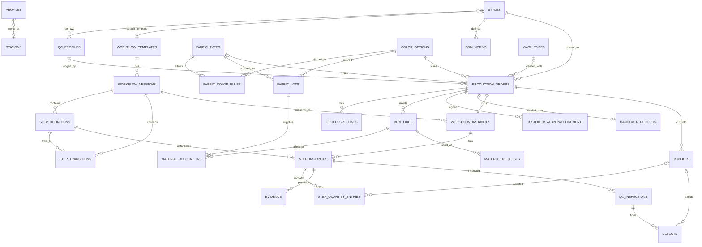

# DATABASE_DESIGN — DenimFlow BO

Phiên bản 0.1 (thiết kế nháp, schema chưa được triển khai) · 2026-10-16 · Ngôn ngữ: VI (bản dịch) · Bản chuẩn: `docs/en/DATABASE_DESIGN.md`
Nguồn: Proposal V2.0 mục 10 (core data model) cộng các bổ sung ở §10 của file này (mã R-xx tham chiếu `BUSINESS_RECONCILIATION.md` §7).

## 1. Nguyên tắc

1. **PostgreSQL trên Supabase**, được NestJS API truy cập qua Prisma. Web không bao giờ query bảng trực tiếp.
2. **Workflow là dữ liệu.** Template → version → step definition → transition. Version đã publish là bất biến (BR-02); đơn trỏ tới một version (snapshot, BR-03).
3. **Toàn vẹn đặt ở database khi rẻ và tuyệt đối** (unique, FK, CHECK, partial unique index, trigger); **các rule cần ngữ cảnh nghiệp vụ nằm ở engine/API** (xem §6).
4. **Mọi thay đổi trạng thái đều để lại một dòng audit** trong cùng transaction (BR-16).
5. **RLS deny-all** cho mọi bảng; phân quyền thật nằm ở API (xem §8).

## 2. Quy ước

| Chủ đề | Quy ước |
|---|---|
| Tên bảng | snake_case số nhiều (`step_instances`); Prisma model PascalCase số ít kèm `@@map` |
| Tên cột | snake_case; field Prisma camelCase kèm `@map` |
| Khoá chính | `id uuid` mặc định `gen_random_uuid()`; `audit_logs.id` là `bigint` identity (để có thứ tự) |
| Timestamp | `timestamptz`, UTC; `created_at`, `updated_at` khi dòng có thay đổi |
| Enum | Enum PostgreSQL qua Prisma enum (§5) |
| Boolean | `is_*` hoặc `*_required`, `NOT NULL` kèm default |
| Số lượng | sản phẩm = `integer` ≥ 0; vải = `numeric(12,2)` mét |
| Xoá mềm | Không dùng. Dòng catalog dùng `is_active`; dòng đang được tham chiếu không xoá được |
| Tiền | ngoài phạm vi |
| File | lưu **path** trong Storage, không lưu URL công khai (R-15) |

## 3. Sơ đồ quan hệ thực thể (ERD)



Không vẽ (sau MVP): `workflow_change_requests`. `audit_logs` là polymorphic (`entity_type`, `entity_id`) và cố ý không có foreign key.

## 4. Các bảng

Ký hiệu: `PK`, `FK → bảng`, `UQ`, `NN` (not null), `CK` (check). Cột `created_at`/`updated_at` không liệt kê là cột chuẩn.

### 4.1 Catalog (module `catalog`, `inventory`)

| Bảng | Cột |
|---|---|
| `profiles` | `id uuid PK` (= `auth.users.id` của Supabase), `full_name NN`, `email NN UQ`, `role Role NN`, `station_id FK → stations NULL`, `is_active NN default true`. Triển khai: `station_id` được thêm ở Sprint 1 cùng bảng `stations`; không có FK sang `auth.users`, để migration chạy được trên Postgres thường (test, CI) |
| `stations` | `id PK`, `code NN UQ`, `name NN`, `station_type StationType NN`, `is_outsourced NN default false` |
| `styles` | `id PK`, `style_code NN UQ`, `name NN`, `fit_type`, `default_template_id FK → workflow_templates NULL`, `has_embroidery NN default false`, `is_active NN` |
| `fabric_types` | `id PK`, `code NN UQ`, `weight_oz numeric(4,1)`, `composition`, `stretch_type StretchType NN` |
| `color_options` | `id PK`, `code NN UQ`, `name NN`, `color_family` |
| `fabric_color_rules` | `id PK`, `fabric_type_id FK NN`, `color_id FK NN`, `is_allowed NN`; **UQ(fabric_type_id, color_id)** |
| `wash_types` | `id PK`, `code NN UQ`, `name NN` (R-08) |
| `fabric_lots` | `id PK`, `fabric_type_id FK NN`, `color_id FK NN`, `lot_no NN UQ`, `available_meters numeric(12,2) NN CK ≥ 0`, `shrinkage_percent numeric(5,2)` |
| `qc_profiles` | `id PK`, `style_id FK NN`, `profile_type QcProfileType NN`, `max_shrinkage_percent numeric(5,2) NN`, `max_color_fading_level smallint NN` (0 = không phai … 5 = phai nặng; càng thấp càng tốt), `is_active NN`; **UQ(style_id, profile_type)** |
| `bom_norms` | `id PK`, `style_id FK NN`, `size NN`, `material_type MaterialType NN`, `qty_per_piece numeric(10,3) NN`, `unit NN`, `wastage_percent numeric(5,2) NN default 0` (R-16) |

### 4.2 Workflow (module `workflow`)

| Bảng | Cột |
|---|---|
| `workflow_templates` | `id PK`, `name NN`, `is_active NN default true`, `is_dedicated NN default false`, `order_id uuid NULL` (nhánh custom sau MVP, R-04), `current_version_id FK → workflow_versions NULL` |
| `workflow_versions` | `id PK`, `template_id FK NN`, `version_no int NN`, `status VersionStatus NN`, `published_at`, `created_by FK → profiles`; **UQ(template_id, version_no)**; **partial UQ(template_id) WHERE status='PUBLISHED'** |
| `step_definitions` | `id PK`, `version_id FK NN`, `code NN`, `name NN`, `step_type StepType NN`, `seq int NN`, `responsible_role Role NN`, `station_type StationType NULL`, `is_mandatory NN`, `requires_evidence NN default false`, `requires_qc NN default false`, `condition_expr jsonb NULL` (JSON AST, R-09), `max_rework smallint NULL`, `is_start NN default false`, `is_end NN default false`; **UQ(version_id, code)** (R-07) |
| `step_transitions` | `id PK`, `version_id FK NN`, `from_step_id FK NN`, `to_step_id FK NN`, `condition_expr jsonb NULL`, `kind TransitionKind NN`; **UQ(version_id, from_step_id, to_step_id, kind)** |

Ví dụ `condition_expr` (kiểm bằng Zod trong `packages/shared`): `{"op":"eq","field":"order.dyeRequired","value":true}`, `{"op":"not","arg":{"op":"eq","field":"order.skipCleanWash","value":true}}`, `{"op":"neq","field":"order.washTypeId","value":null}`.

### 4.3 Đơn sản xuất (module `order`, `inventory`)

| Bảng | Cột |
|---|---|
| `production_orders` | `id PK`, `order_number NN UQ` (`PO-YYYY-NNNN`), `style_id FK NN`, `fabric_type_id FK NULL`, `color_id FK NULL`, `wash_type_id FK → wash_types NULL`, `dye_required NN default false`, `dye_mode DyeMode NULL`, `dye_source DyeSource NULL`, `embroidery_required NN default false`, `fabric_inspect_required NN default false`, `pp_sample_required NN default false`, `skip_clean_wash NN default false`, `qc_profile_id FK NULL` (gán lúc Confirm), `is_custom NN default false`, `status OrderStatus NN default DRAFT`, `due_date date NN`, `customer_ref`, `notes`, `created_by FK NN`, `confirmed_at NULL`, `version int NN default 0` (optimistic lock tuỳ chọn); **CK** `NOT dye_required OR (dye_mode IS NOT NULL AND dye_source IS NOT NULL)` |
| `order_size_lines` | `id PK`, `order_id FK NN`, `size NN`, `planned_qty int NN CK > 0`; **UQ(order_id, size)** |
| `bom_lines` | `id PK`, `order_id FK NN`, `material_type MaterialType NN`, `required_qty numeric(12,3) NN`, `unit NN` |
| `material_allocations` | `id PK`, `bom_line_id FK NN`, `fabric_lot_id FK NN`, `allocated_qty numeric(12,3) NN CK > 0` |
| `material_requests` | `id PK`, `order_id FK NN`, `bom_line_id FK NN`, `missing_qty numeric(12,3) NN`, `status RequestStatus NN default OPEN`, `requested_by FK NN` (R-02) |
| `customer_acknowledgements` | `id PK`, `order_id FK NN`, `ack_type AckType NN`, `qc_profile_id FK NN`, `file_path NN`, `acknowledged_by_name NN` (người ký phía khách), `acknowledged_at NN`, `recorded_by FK NN` (R-15) |
| `handover_records` | `id PK`, `order_id FK NN UQ`, `qc_profile_id FK NN`, `packing_list jsonb NN`, `total_qty int NN`, `handed_over_by FK NN`, `handed_over_at NN`, `notes` (R-16) |

### 4.4 Vận hành (module `execution`, `quality`, `audit`)

| Bảng | Cột |
|---|---|
| `workflow_instances` | `id PK`, `order_id FK NN UQ`, `version_id FK NN`, `status InstanceStatus NN` |
| `step_instances` | `id PK`, `instance_id FK NN`, `step_definition_id FK NN`, `status StepStatus NN default PENDING`, `assigned_to FK NULL`, `performed_by FK NULL`, `started_at`, `completed_at`, `qty_in int NULL`, `qty_good int NULL`, `qty_defect int NULL`, `rework_count smallint NN default 0`; **UQ(instance_id, step_definition_id)**; **CK** số lượng ≥ 0 |
| `bundles` | `id PK`, `order_id FK NN`, `bundle_code NN`, `size NN`, `qty int NN CK > 0`, `current_step_instance_id FK NULL`; **UQ(order_id, bundle_code)** |
| `step_quantity_entries` | `id PK`, `step_instance_id FK NN`, `bundle_id FK NULL`, `size NULL`, `qty_good int NN CK ≥ 0`, `qty_defect int NN CK ≥ 0`, `note`, `entered_by FK NN`, `entered_at NN` — append-only (R-03) |
| `evidence` | `id PK`, `step_instance_id FK NN`, `file_path NN`, `note`, `uploaded_by FK NN`, `uploaded_at NN` |
| `qc_inspections` | `id PK`, `step_instance_id FK NN`, `inspector_id FK NN`, `qc_profile_id FK NULL`, `sample_size int NN`, `measured_shrinkage_percent numeric(5,2) NULL`, `measured_color_fading_level smallint NULL`, `result QcResult NN`, `rework_target_step_id FK → step_instances NULL`, `reason`, `notes` |
| `defects` | `id PK`, `inspection_id FK NN`, `bundle_id FK NULL`, `defect_type NN`, `qty int NN CK > 0` |
| `audit_logs` | `id bigint PK` tự tăng (`bigserial`, Prisma `autoincrement()`), `entity_type NN`, `entity_id uuid NN`, `action NN`, `old_value jsonb`, `new_value jsonb`, `actor_id uuid NULL` (NULL = hệ thống), `created_at NN default now()` — **append-only** |
| `workflow_change_requests` *(sau MVP)* | `id PK`, `instance_id FK`, `requested_by FK`, `payload jsonb`, `status ChangeRequestStatus`, `approved_by FK NULL` |

## 5. Enum

| Enum | Giá trị |
|---|---|
| `Role` | ADMIN, PROCESS_ENGINEER, PRODUCTION_PLANNER, WAREHOUSE_KEEPER, STATION_OPERATOR, QC_INSPECTOR, MANAGER |
| `StationType` | CUTTING, SEWING, EMBROIDERY, DYEING, WASH, FINISHING, QC, PACKING |
| `StretchType` | RIGID, STRETCH |
| `QcProfileType` | FULL_PROCESS, SKIP_CLEAN_WASH |
| `VersionStatus` | DRAFT, PUBLISHED, RETIRED |
| `StepType` | SELECTION, MATERIAL, PRODUCTION, QC, APPROVAL |
| `TransitionKind` | NORMAL, REWORK |
| `OrderStatus` | DRAFT, CONFIRMED, IN_PRODUCTION, ON_HOLD, COMPLETED, CANCELLED |
| `InstanceStatus` | RUNNING, COMPLETED, CANCELLED |
| `StepStatus` | PENDING, READY, IN_PROGRESS, WAITING_QC, REWORK, DONE, SKIPPED |
| `DyeMode` | TOTAL, PARTIAL |
| `DyeSource` | INTERNAL, OUTSOURCED |
| `MaterialType` | FABRIC, THREAD, BUTTON, RIVET, ZIPPER, LABEL, PACKAGING |
| `RequestStatus` | OPEN, ORDERED, RECEIVED, CANCELLED |
| `AckType` | SKIP_CLEAN_WASH |
| `QcResult` | PASS, REWORK, REJECT |
| `ChangeRequestStatus` | PENDING, APPROVED, REJECTED |

Cùng các enum này được định nghĩa một lần trong `packages/shared` và phản chiếu trong `schema.prisma`; phải giữ hai nơi giống hệt nhau.

## 6. Ràng buộc toàn vẹn và index

| Rule | Cơ chế ở database | Phần còn lại ở engine/API |
|---|---|---|
| BR-02 chỉ một version PUBLISHED mỗi template | Partial unique index `workflow_versions(template_id) WHERE status='PUBLISHED'` | Use-case publish retire version cũ trong cùng transaction |
| BR-02 version đã publish bất biến | Trigger `BEFORE INSERT/UPDATE/DELETE` trên `step_definitions` và `step_transitions`, raise lỗi nếu version cha không phải DRAFT | API cũng từ chối (thông báo thân thiện) |
| BR-16 AuditLog append-only | Trigger `BEFORE UPDATE OR DELETE` trên `audit_logs` raise exception; statement trigger `BEFORE TRUNCATE` | Ghi trong cùng transaction với thay đổi |
| BR-04 cặp vải–màu hợp lệ | `UQ(fabric_type_id, color_id)` trên matrix | API kiểm tra `is_allowed` |
| BR-06 phân bổ ≤ tồn kho | `CK available_meters ≥ 0` trên `fabric_lots`; row lock khi phân bổ (§7) | Gate (engine) cho CUTTING |
| BR-08 bảo toàn số lượng | `CK` số lượng không âm; row lock trên `step_instances` (§7.2) | So sánh giữa các step nằm ở engine (không thể là CHECK) |
| BR-19 giấy xác nhận trước Confirm | — | Use-case Confirm kiểm tra tồn tại dòng `customer_acknowledgements` |
| Một instance mỗi đơn | `UQ(order_id)` trên `workflow_instances` | — |
| Dữ liệu nhuộm đầy đủ | `CK` trên `production_orders` (§4.3) | — |

Index (ngoài PK/UQ ở trên): các cột FK dùng khi join (`step_instances.instance_id`, `step_instances.step_definition_id`, `order_size_lines.order_id`, `bom_lines.order_id`, `material_allocations.bom_line_id`, `bundles.order_id`, `evidence.step_instance_id`, `qc_inspections.step_instance_id`); worklist `step_instances(status)` kèm join tới `step_definitions(station_type, responsible_role)`; dashboard `production_orders(status, due_date)`; audit `audit_logs(entity_type, entity_id, created_at)` và `audit_logs(created_at)`. Chỉ thêm index khác sau khi đã đo.

## 7. Transaction và đồng thời (concurrency)

Dùng **interactive transaction** của Prisma (`prisma.$transaction(async (tx) => ...)`). Kết nối pooled (transaction mode) hỗ trợ được vì toàn bộ transaction chạy trên một connection.

### 7.1 Confirm đơn (FR-07, BR-03, BR-18, BR-19)

```
BEGIN
 1. SELECT order FOR UPDATE; yêu cầu status = DRAFT            -- Confirm lần hai sẽ chờ rồi thất bại (409)
 2. style → default template → version PUBLISHED (nếu không có: lỗi BR-03)
 3. kiểm dữ liệu đầy đủ; từ chối isCustom (R-04);
    nếu skip_clean_wash: yêu cầu có dòng customer_acknowledgements (BR-19)
 4. chọn qc_profile theo skip_clean_wash → orders.qc_profile_id
 5. engine.buildInstance(stepDefinitions, orderFlags) → trạng thái ban đầu của từng step
    (condition sai → SKIPPED; CLEAN_WASH bị bỏ qua theo cờ → SKIPPED + audit)
 6. INSERT workflow_instances + step_instances; ORDER_CONFIRM = DONE (R-05); step đủ điều kiện đầu tiên READY
 7. UPDATE order status = CONFIRMED, confirmed_at
 8. INSERT audit_logs (đơn, instance, từng step bị skip)
COMMIT                                                          -- lỗi bất kỳ ⇒ ROLLBACK, không có dữ liệu dở dang
```

### 7.2 Nhập số lượng (FR-13, BR-07, BR-08, BR-09)

```
BEGIN
 1. SELECT ... FROM step_instances WHERE id = :id FOR UPDATE    -- tuần tự hoá các lần nhập trên cùng một step
    (khoá cả dòng step trước, luôn theo thứ tự id tăng dần để tránh deadlock)
 2. engine.validateQuantityEntry(current, previous, entry, tolerance)
 3. INSERT step_quantity_entries; UPDATE số tổng trên step_instances
 4. INSERT audit_logs
COMMIT
```

| Cách tiếp cận | Ưu | Nhược |
|---|---|---|
| **Pessimistic lock (`FOR UPDATE`) — được chọn** | Dễ suy luận; không cần logic retry; khớp rule "hai lần nhập không được cùng vượt" | Giữ lock trong thời gian ngắn; cần raw query trong Prisma |
| Optimistic (cột `version` + retry) | Không cần lock | Phải viết retry ở mọi đường ghi; xung đột lộ ra cho người dùng |

Phân bổ (`material_allocations`) dùng cùng mẫu này trên dòng `fabric_lots`.

### 7.3 Quyết định QC (FR-16, FR-17, BR-10, BR-11, BR-19)

Khoá dòng step được kiểm (và step đích rework); kiểm tra BR-11 (inspector ≠ người thực hiện); engine chọn ngưỡng từ `qc_profile_id` của đơn và trả về kết quả đề xuất; insert `qc_inspections`; nếu REWORK thì đặt step đích thành `REWORK` và tăng `rework_count` (vượt `max_rework` ⇒ gắn cờ cho Planner, BR-10); ghi các dòng audit; tất cả trong một transaction.

## 8. Bảo mật

- `ALTER TABLE ... ENABLE ROW LEVEL SECURITY` trên **mọi** bảng, **không có policy nào**. Supabase mở các bảng qua REST API tự sinh bằng anon key; RLS deny-all làm API đó không trả gì. Prisma kết nối bằng role có đặc quyền và bỏ qua RLS, nên phân quyền được cài ở API.
- Thêm một query kiểm tra trong CI/dev liệt kê các bảng ở schema `public` không bật RLS và fail nếu có (test API `enables RLS on every table in the public schema`). Bảng `_prisma_migrations` của Prisma cũng nằm trong `public`, nên migration đầu tiên bật RLS cho nó.
- Storage: một bucket **private** cho minh chứng và giấy xác nhận; object path `orders/{orderId}/{kind}/{uuid}.{ext}`; signed URL hết hạn ngắn; API kiểm tra loại file và dung lượng trước khi cấp URL upload.
- Connection string: `DATABASE_URL` dạng pooled (transaction mode, tham số kiểu `pgbouncer=true` tuỳ phiên bản Prisma) cho runtime; `DIRECT_URL` (direct hoặc session pooler) cho migration.

## 9. Seed data (`prisma/seed.ts`, idempotent, chỉ dữ liệu giả)

- 7 user (mỗi role một người) với email dạng `admin@denimflow.test`; mật khẩu ban đầu đọc từ `SEED_DEFAULT_PASSWORD` (không bao giờ commit).
- Station: mỗi loại một trạm (DYEING đánh dấu `is_outsourced`).
- Catalog: Style `JN-SLIM-01`; FabricType `DN-12-RIGID`; màu Indigo, Black, Grey; matrix: Indigo và Black được phép, Grey không; các loại wash (ví dụ `STONE_WASH`, `ENZYME_WASH`, `DISTRESSED`); một dòng `fabric_lots` với nhiều mét vải; `bom_norms` cho size 28–34.
- `qc_profiles` (placeholder để demo, R-14): FULL_PROCESS co rút ≤ 3,0 %, phai màu ≤ 1; SKIP_CLEAN_WASH co rút ≤ 5,0 %, phai màu ≤ 2.
- Template "Jean Standard": 14 step và transition theo `BUSINESS_RECONCILIATION.md` §3, version 1 PUBLISHED, gán cho `JN-SLIM-01`.

## 10. Điểm khác so với data model của Proposal

| Proposal | Thiết kế này | Ref |
|---|---|---|
| `User` có `passwordHash` | `profiles` liên kết với Supabase Auth | R-01 |
| (không có) | `material_requests` | R-02 |
| Số lượng chỉ trên `StepInstance` | thêm `step_quantity_entries` append-only | R-03 |
| `stationType` trên step | thêm `responsible_role`, `requires_qc`, `seq`, `is_start`, `is_end`; `station_type` cho phép null | R-07 |
| thuộc tính `washType` | catalog `wash_types` + `wash_type_id`; cờ mới của đơn `embroidery_required`, `fabric_inspect_required`, `pp_sample_required` | R-08 |
| `conditionExpr` dạng biểu thức | JSON AST trong `jsonb` | R-09 |
| các trường `fileUrl` | `file_path` trong bucket private | R-15 |
| (không có) | `handover_records`, `bom_norms` | R-16 |
